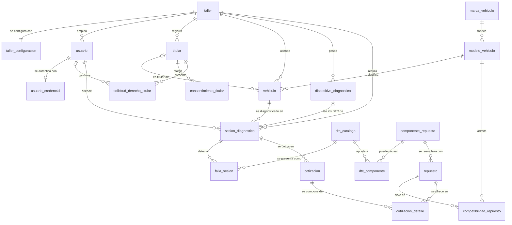
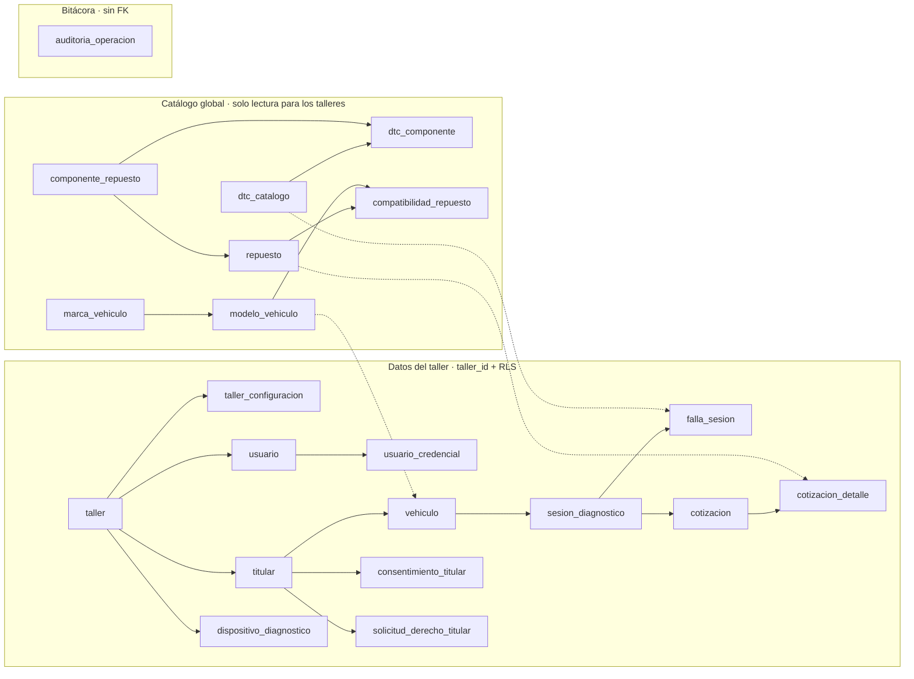
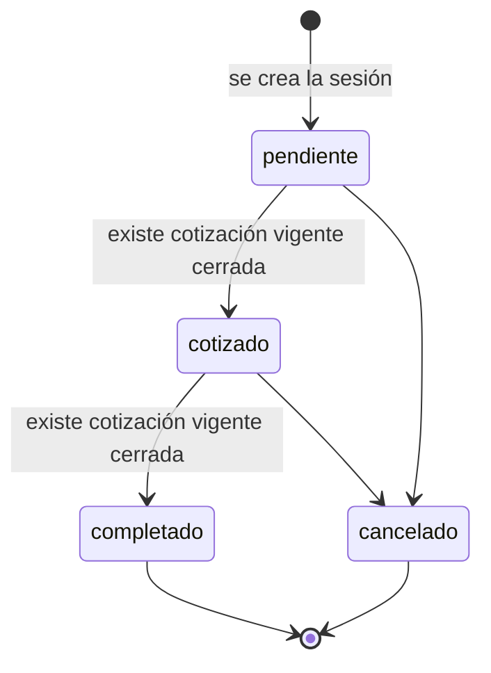
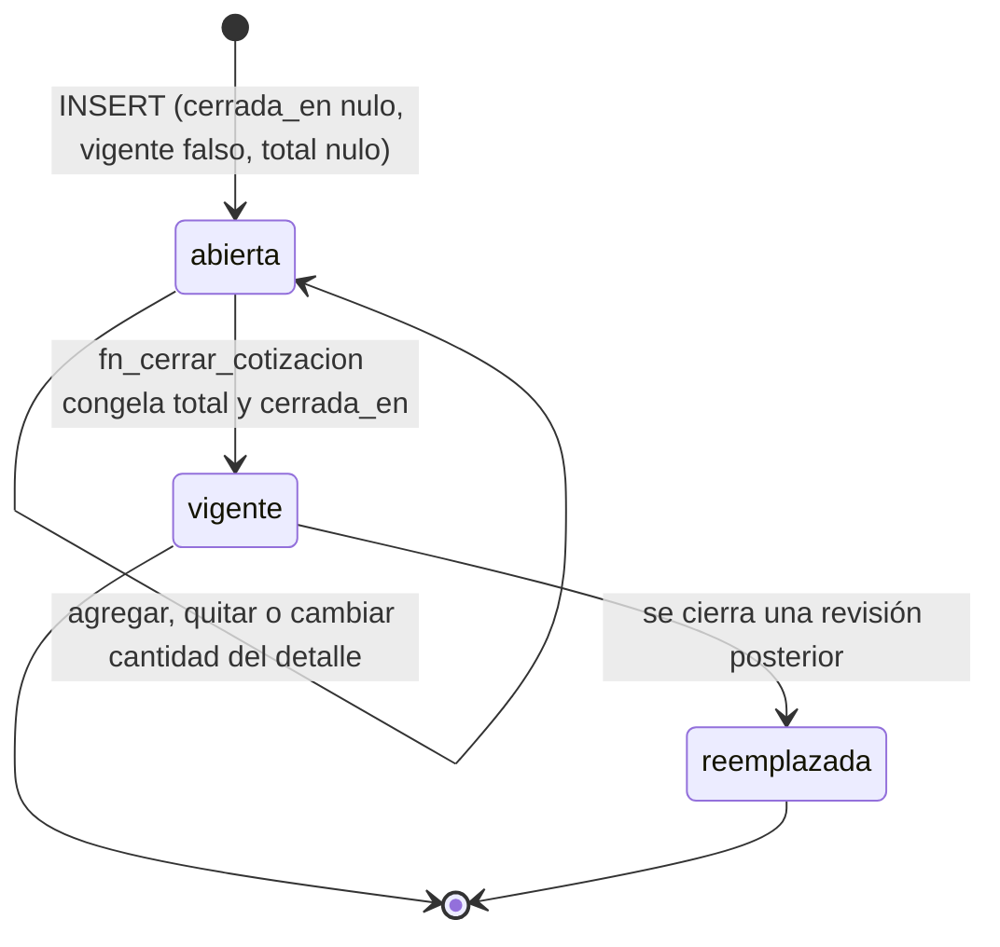
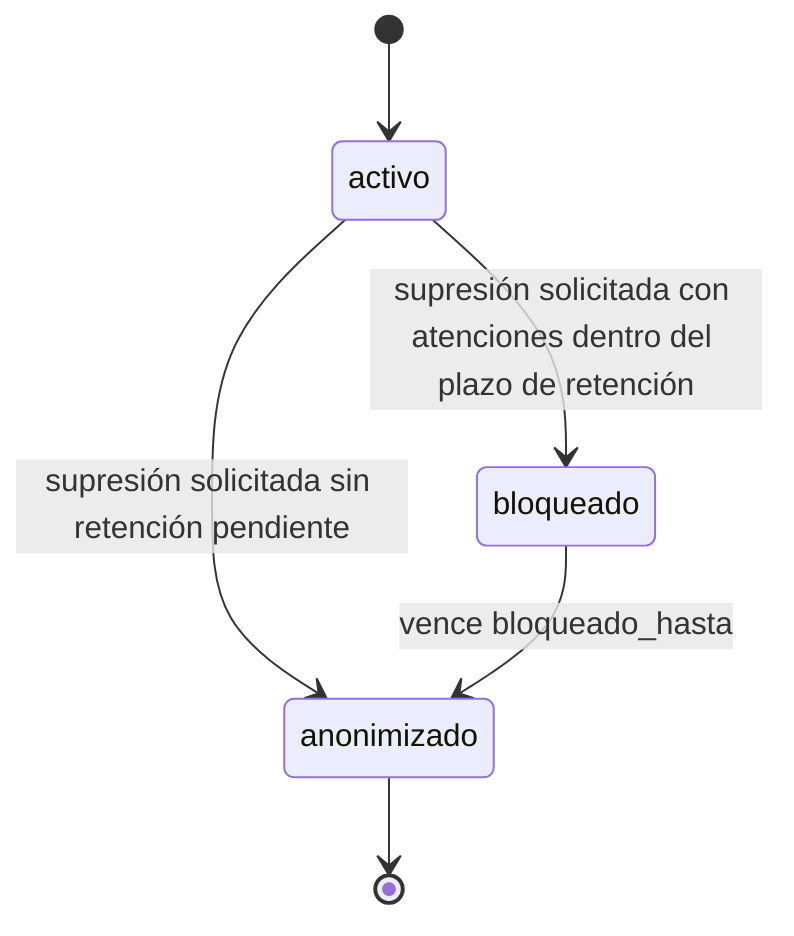

# 2. Modelo conceptual

Diagramas en Mermaid (se ven en GitHub, VS Code con extensión Mermaid o <https://mermaid.live>).
Notación: `||` exactamente uno · `|o` cero o uno · `o{` cero o muchos · `|{` uno o muchos.

## 2.1 Vista general

`auditoria_operacion` no aparece relacionada con nada: es deliberado. Guarda `taller_id`, `usuario_id`,
`tabla` y `registro_id` como **valores**, sin claves foráneas, para sobrevivir a cualquier cambio del
esquema y no bloquear ninguna operación.

## 2.2 Las tres zonas del modelo

Las flechas punteadas son los únicos tres puntos donde un dato del taller referencia al catálogo global.
Las flechas van de padre a hijo.

## 2.3 Ciclo de vida de la atención

No existe `cotizado → pendiente` ni salida desde un estado terminal. En `cotizado` se pueden crear
revisiones nuevas de la cotización; cada cierre reemplaza a la vigente.

## 2.4 Ciclo de vida de la cotización

"Abierta", "vigente" y "reemplazada" no son un enum: se deducen de `cerrada_en` y `vigente`
(abierta = `cerrada_en IS NULL`; vigente = cerrada y `vigente`; reemplazada = cerrada y no `vigente`).

## 2.5 Ciclo de vida del tratamiento de datos del titular

La anonimización es irreversible: no hay transición de salida.
